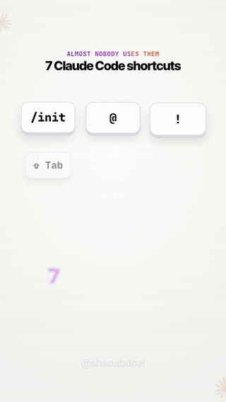
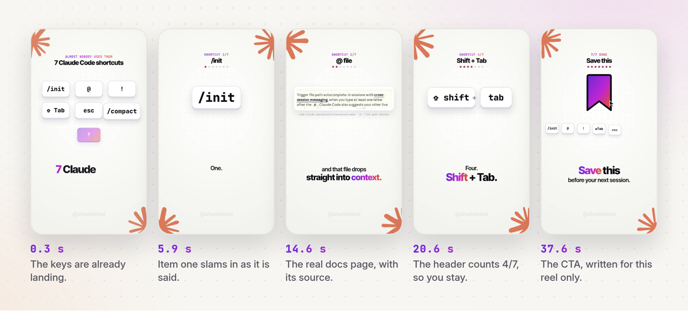

# kinetic-reels

**An agent skill that makes a finished vertical reel from one topic.** Voiceover, word-by-word captions, real screenshots moving on screen, sound effects, free music. You get an MP4 that's ready to post on Instagram, TikTok, YouTube Shorts or LinkedIn.

It runs inside the coding agent you already use: **Claude Code, Codex, OpenCode or Antigravity**.

<p align="center"></p>

That reel ([full MP4, 39 s](docs/example.mp4)) came out of this skill. The same files are in `skills/kinetic-reels/examples/claude-code-shortcuts`, so you can render it yourself and check you get the same video.



## What it does, in plain words

You tell your agent: *"Make a reel about the 5 Cursor shortcuts I use every day."*

The agent then:
1. reads the real docs and writes down every fact with its source,
2. writes a script that puts the payoff in the first line,
3. makes the voice with Google's Gemini TTS (your own free API key),
4. times every caption word to the real voice,
5. takes real screenshots of the pages it talks about,
6. builds the reel as one web page and checks its own layout every 0.2 seconds,
7. adds sound effects and a quiet CC0 music bed,
8. renders 30 frames per second and hands you `final.mp4` plus a cover.

No timeline editor. No templates you drag around. And no stock footage either.

## Install

You need **Node.js 18+**, **Python 3.10+** and **ffmpeg**. The skill checks all of it for you. (On Mac and Linux, type `python3` wherever this page says `python`.)

**Any agent (Claude Code, Codex, OpenCode, Antigravity):**
```bash
npx skills add Shaddy37/kinetic-reels
```

**Claude Code as a plugin:**
```
/plugin marketplace add Shaddy37/kinetic-reels
/plugin install kinetic-reels@kinetic-reels
```

**By hand:** clone this repo and copy the folder `skills/kinetic-reels` to `~/.claude/skills/` (Claude Code), `~/.agents/skills/` (Codex, OpenCode, Antigravity) or `.agents/skills/` inside one project.

Then, once, from the skill folder:
```bash
node scripts/setup.mjs
```
It installs the renderer (Playwright + Chromium) and two Python packages, then runs the doctor. If something's missing, it tells you the exact command for your system.

## The voice key (free)

1. Go to [aistudio.google.com/apikey](https://aistudio.google.com/apikey), sign in, click **Create API key**.
2. In your project folder, make a file called `.env` with one line:
   ```
   GEMINI_API_KEY=paste-your-key-here
   ```
3. Never commit that file. The `.gitignore` here already ignores it.

Google gives a free tier with daily limits that differ per project. One reel is one voice request. If you ever pass the limit, a 45-second voiceover costs about one cent.

## Your first reel

Open your agent in any project folder and say:

> Use the kinetic-reels skill. Make a 40-second reel about [your topic].

It'll ask for your handle, your name and a square photo for the end card (it stores them in `kinetic.config.json`), show you the plan, then build it. The output lands in `reels/<name>/out/final.mp4`.

Want to see the whole pipeline work before you spend a voice request? Render the example:
```bash
cd skills/kinetic-reels/examples/claude-code-shortcuts
python ../../scripts/tighten.py .
python mix.py
node ../../engine/render.cjs .
python ../../scripts/finish.py .
```

## What's inside

```
skills/kinetic-reels/
  SKILL.md            the instructions your agent follows
  references/         script + hook rules, voice tags, components, sound, assets, troubleshooting
  engine/             the reel engine (core_a.js, core_b.js, motion.js) + render.cjs and the layout judge shot.cjs
  template/           a working starter reel (reel.html, reel.js, tts.json, script.txt, mix.py)
  scripts/            setup, doctor, new-reel, voice, tighten, captions, docshot, music, finish
  assets/             fonts (OFL), logos, one CC0 music track
  examples/           the gold reel, with its voice take
```

## Why it looks the way it does

These rules came from posting reels and watching the numbers, not from a style guide:
- **Payoff in line 1, motion on frame 0.** Most people decide in the first few seconds.
- **One look from start to end.** An early reel opened dark and flipped to light, and people swiped right at the flip. It looked like a new video.
- **A counter for lists** (`3/7` with dots), plus an open loop in line 2 that pays off at the end.
- **Real proof on screen.** Docs, repos and pricing pages, each with a source line.
- **Quiet music.** The voice always sits on top.

## License

MIT for the code. Fonts: Inter, Inter Tight, JetBrains Mono and DM Serif Display under the SIL Open Font License. Music: "Chill Beat" by Seth_Makes_Sounds, CC0 ([source](https://freesound.org/people/Seth_Makes_Sounds/sounds/678003)). Logos belong to their owners and are only there to name the tools a reel talks about.

Made by [Shadab Shams](https://aifloxium.online). If you post something you made with it, I'd love to see it.
